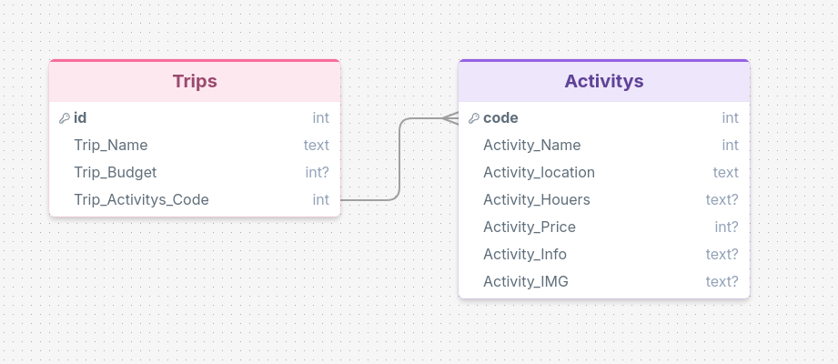

# Sprint 1 - Developing a DB and UI Prototype

## Sprint Goals

The goal of this sprint was to design the database structure for my road trip planning website before implementing it in Sprint 2. I identified the information that needed to be stored, how the different tables would be connected, and how the database would retrieve and organise information.

### Specific Goals

  - Key pages
  - User interactions and 'flow'
- Identify the information that needs to be stored in the database.
- Design the required database tables.
- Identify the fields and appropriate data types for each table.
- Choose primary keys to uniquely identify records.
- Establish relationships between tables using foreign keys or matching key fields.
- Identify default and nullable values where required.
- Determine the required input and output data.
- Plan how the database will process and retrieve information for the website.

## Initial Database Design

The database will store the information required for users to create and manage road trip plans. It needs to store information about individual trips and the activities associated with each trip.

I designed separate tables to organise this information rather than storing everything in one large table. This helps reduce duplicated data and makes it easier to manage individual trips and their activities.

Each table uses an ID or code field to identify records. The trips table stores the main road trip information, while the Activitys table stores the activities associated with each trip.

### Tables and Fields

The database uses separate tables to organise different types of information.

The trips table stores information about each road trip, including its name and budget. The Activitys table stores information about individual activities, including their name, location, hours, price, description and image.

Each table has identifying fields so that individual records can be retrieved and managed. The activity code is also used to connect activities to their associated road trip.

### Primary Keys and Relationships

Each road trip and activity needs a unique identifier so that individual records can be retrieved, updated or deleted without affecting unrelated records.

The database uses an ID field to identify individual trips and activities. Activities are associated with trips using a matching code between the `Trip_Activitys_Code` field in the trips table and the `Code` field in the Activitys table.

This relationship allows multiple activities to be associated with one road trip. It also means that when a user views a trip, the database can retrieve all the activities belonging to that trip.

### Data Types and Values

The database uses different data types depending on the information being stored.

For example, text fields are used for trip names, activity names, locations and descriptions. Numeric fields are used for budgets, prices and identifying numbers.

Unique IDs are used to distinguish individual records. These can be automatically generated by the database when new records are inserted.

Some fields may also require default or nullable values depending on whether the information is essential. This helps prevent unnecessary information from being required when creating a trip or activity.

## Required Data Input

The user will input information about their road trip through the website's forms.

For a road trip, this includes the trip name and budget. For activities, this includes the activity name, location, estimated hours, price, additional information and an image.

This information is submitted through the website and processed by the Flask backend before being stored in the appropriate database table.

The database needs to organise the submitted information into the correct fields and associate each activity with its corresponding road trip.

## Required Data Output

The system will retrieve and display information stored in the database through the website.

The home page will display saved road trips, including their names and budgets. When a user selects a trip, the details page will display the selected trip's information along with its associated activities.

The output will be presented as dynamically generated web pages using the information retrieved from the database.

The system is also intended to display estimated total trip costs and calculated driving routes between locations as further functionality is developed.

## Required Data Processing

The database will process information entered by users so that it can be retrieved and displayed correctly.

SQL queries will be used to retrieve, insert, update and delete records. Queries will also use matching key fields to retrieve activities associated with a particular road trip.

The system will eventually process activity and fuel costs to calculate an estimated total trip cost.

It will also process the locations entered by the user to calculate an exportable driving route between locations.

## Database Design Review

During this sprint, I established the initial structure of the database and identified the information required to manage road trips and their activities.

Separating trips and activities into different tables allows the database to organise information more efficiently and makes it easier to associate multiple activities with individual trips.

The design also establishes the key fields and relationships needed for retrieving information from multiple tables.

This database design provided the foundation for Sprint 2, where I implemented the database, added test data and connected it to the website using Flask.

## UI 'Flow'

The first stage of prototyping was to explore how the UI might 'flow' between states, based on the required functionality.

This Figma demo shows the initial design for the UI 'flow':

**FIGMA FLOW - PLACE THE FIGMA EMBED CODE HERE - MAKE SURE IT IS SET SO THAT EVERYONE CAN ACCESS IT**

### Testing

<!-- Replace this text with notes about what you did to test the UI flow and the outcome of the testing. -->

### Changes / Improvements

<!-- Replace this text with notes any improvements you made as a result of the testing. -->

*IMPROVED FIGMA FLOW - PLACE THE FIGMA EMBED CODE HERE - MAKE SURE IT IS SET SO THAT EVERYONE CAN ACCESS IT*

## Initial UI Prototype

The next stage of prototyping was to develop the layout for each screen of the UI.

This Figma demo shows the initial layout design for the UI:

*FIGMA PROTOTYPE - PLACE THE FIGMA EMBED CODE HERE - MAKE SURE IT IS SET SO THAT EVERYONE CAN ACCESS IT*

### Testing

<!-- Replace this text with notes about what you did to test the UI flow and the outcome of the testing. -->

### Changes / Improvements

<!-- Replace this text with notes about what you did to test the UI flow and the outcome of the testing. -->

*FIGMA IMPROVED PROTOTYPE - PLACE THE FIGMA EMBED CODE HERE - MAKE SURE IT IS SET SO THAT EVERYONE CAN ACCESS IT*

## Refined UI Prototype

Having established the layout of the UI screens, the prototype was refined visually, in terms of colour, fonts, etc.

This Figma demo shows the UI with refinements applied:

*FIGMA REFINED PROTOTYPE - PLACE THE FIGMA EMBED CODE HERE - MAKE SURE IT IS SET SO THAT EVERYONE CAN ACCESS IT*

### Testing

<!-- Replace this text with notes about what you did to test the UI flow and the outcome of the testing. -->

### Changes / Improvements

<!-- Replace this text with notes about any improvements you made as a result of the testing. -->

*FIGMA IMPROVED REFINED PROTOTYPE - PLACE THE FIGMA EMBED CODE HERE - MAKE SURE IT IS SET SO THAT EVERYONE CAN ACCESS IT*

## Sprint Review

The sprint has moved the project forward by establishing the initial database and UI design for the road trip planning app. The main requirements have been identified, including adding locations and activities, tracking activity and fuel costs, calculating routes, saving multiple trip plans, and exporting routes to Google Maps.

The prototype also considers usability, accessibility, privacy, functionality, and future proofing. Further testing and refinement will be needed before moving into Sprint 2, particularly for features such as route calculation, budget tracking, and route exporting.