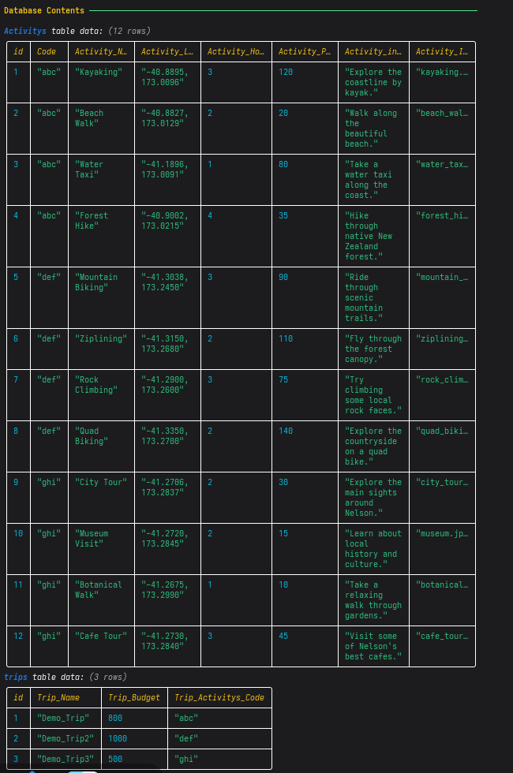
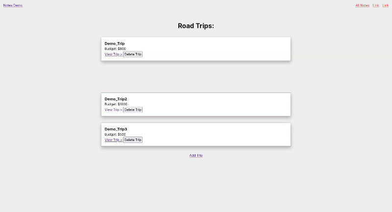
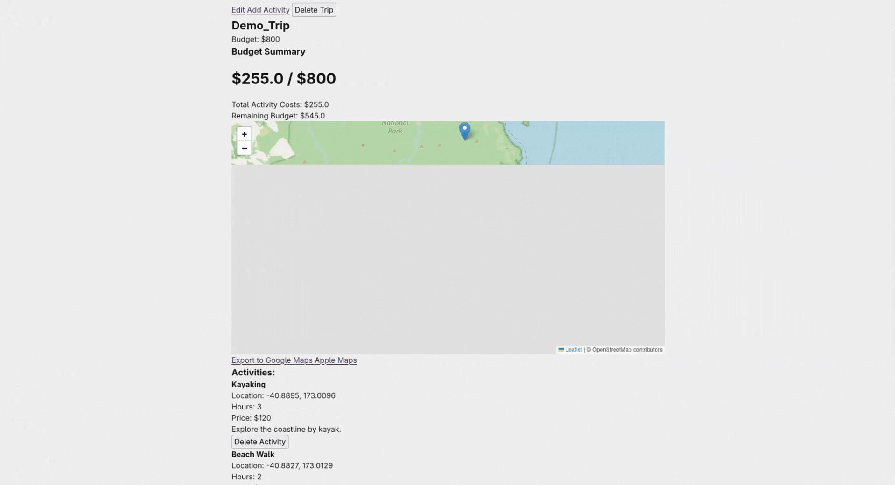
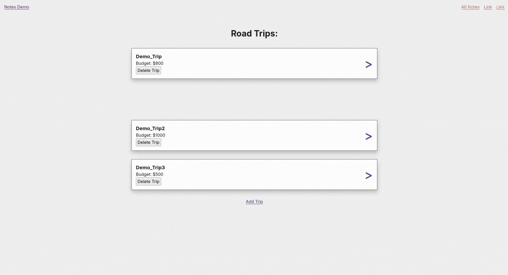
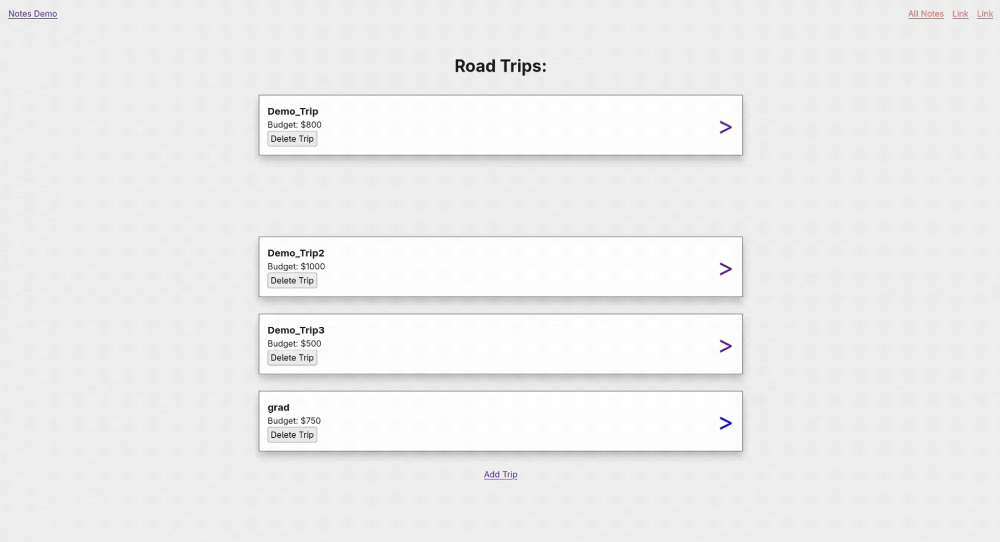
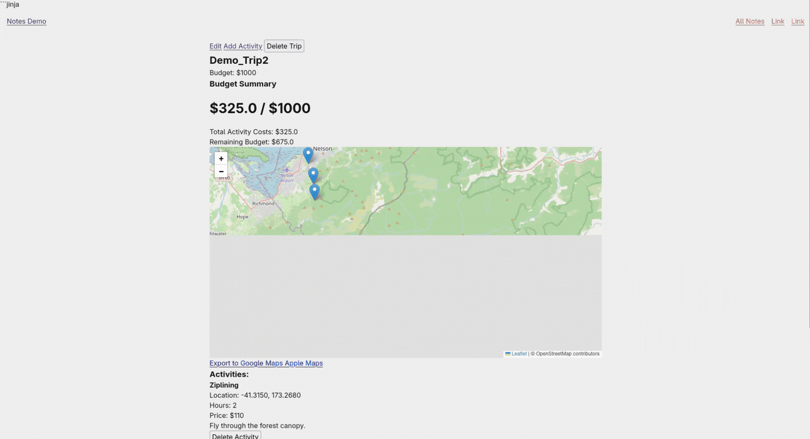
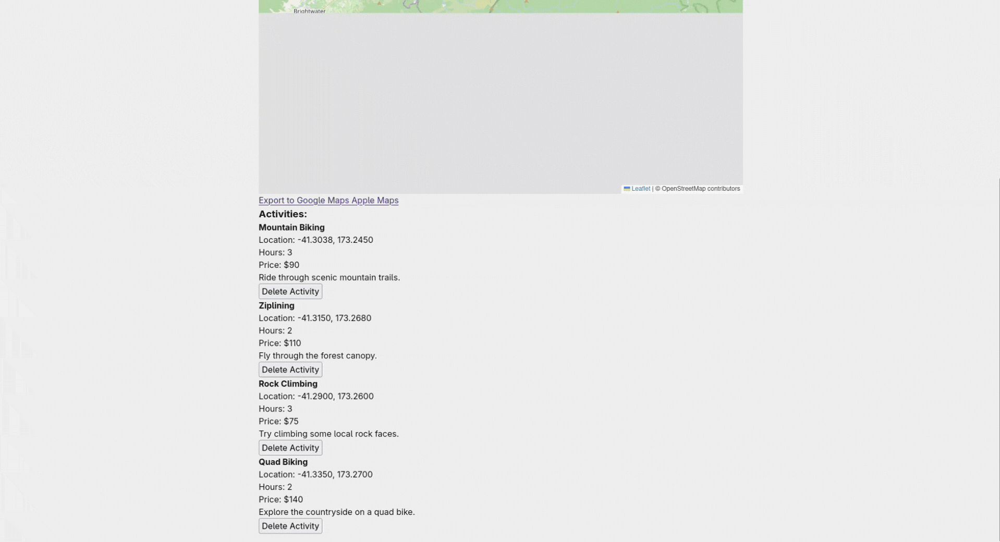

# Sprint 2 - Implement Database and Display of Test Data

## Sprint Goals

The goal of this sprint was to implement the database for my road trip planning website and populate it with test data. I also developed the Flask backend to retrieve, process and display information from the database on the website.

During this sprint, I implemented the main database functionality, allowing users to view saved road trips, view individual trip details, add new trips, add activities to existing trips, and delete trips and activities.

### Specific Goals

- Create the database and its tables.
- Add test data for road trips, locations, activities and costs.
- Create a home page to display saved road trips.
- Create a details page to display information about a selected trip.
- Create SQL queries to retrieve all trips and specific trip details.
- Use primary keys and related fields to link activities to their associated road trips.
- Allow users to add and delete road trips using database queries.
- Allow users to add and delete activities using database queries.
- Dynamically retrieve and display database information on the website.
- Test the database and check that information is stored, retrieved, displayed and deleted correctly.

## Testing Database and Test Data

I tested the database by adding sample road trip and activity data and checking that the information was stored correctly. I checked that both tables contained their seed data and that the information was stored in the correct fields.

The database uses separate tables to organise road trips and activities. Each record has an ID used to identify individual entries. Activities are associated with road trips using the `Trip_Activitys_Code` field in the trips table, which matches the `Code` field in the Activitys table. This allows multiple activities to be associated with the correct road trip without having to store all the activity information directly in the trips table.

I also tested retrieving the stored information using SQL `SELECT` queries to make sure the database returned the correct records.

**Outcome:** Both tables contained their seed data in the correct places with no issues. The database queries successfully retrieved the stored information, and the records were displayed as expected.

## Testing Home Page

I tested the home page to check that road trips could be retrieved from the database and displayed correctly.

The Flask backend uses an SQL `SELECT` query to retrieve the trip ID, name, budget and associated activity code from the trips table. The query uses `ORDER BY id` to organise the results by their ID.

The retrieved records are then passed into the Jinja template, which dynamically displays the information on the website. This means the home page does not rely on manually entered or hardcoded trip information. Instead, it retrieves the current information directly from the database whenever the page is loaded.

The home page uses a GET request to retrieve and display the information.

**Outcome:** The trips were rendered successfully, and the SQL query worked correctly to retrieve the information from the database. All the data was displayed correctly on the website.

## Testing Trip Details

I tested the trip details page to check that the correct information was displayed for the selected road trip. This included checking the locations, activities and costs stored in the database.

The website uses a dynamic URL containing the trip's ID to identify which road trip the user wants to view. The backend then uses a parameterised SQL `SELECT` query with a `WHERE` condition to retrieve only the matching trip.

Once the trip has been retrieved, another SQL query is used to find all activities associated with it. This query matches the trip's `Trip_Activitys_Code` with the `Code` field in the Activitys table.

This demonstrates how related data can be retrieved from separate database tables using matching key fields. The retrieved trip and activity records are then passed into the Jinja template and displayed together on the trip details page.

I also included a check to make sure the selected trip actually exists in the database. If the requested ID does not match an existing trip, the website returns a 404 error instead of trying to display information that does not exist.

**Outcome:** All the information was displayed and organised correctly. The SQL queries successfully retrieved the selected trip and its associated activities, with no issues during testing.

## Testing Adding Road Trips

I tested the functionality for adding new road trips to the website. I entered the required information into the trip form, including the trip name and budget, and checked that it was successfully saved to the database and appeared on the home page.

When the form is submitted, the website sends a POST request to the Flask backend. The backend retrieves the submitted form data and uses an SQL `INSERT` query to create a new record in the trips table.

The query inserts the trip name and budget into their corresponding database fields. The database also uses its ID field to identify the individual trip.

I used parameterised SQL queries with `?` placeholders rather than directly inserting user input into the SQL statement. This helps protect the database against SQL injection by treating submitted values as data rather than executable SQL commands.

After the database has been updated, the website redirects the user back to the trips page, where the newly created trip is retrieved and displayed.

**Outcome:** Adding a new trip worked successfully. Entering the information into the form sent a POST request, which inserted the new record into the database. The website then redirected to the trips page, where the new trip was displayed correctly.

## Testing Deleting Road Trips

I tested the functionality for deleting road trips from the website. I selected an existing trip and deleted it, then checked that it was removed from the database and no longer appeared on the home page.

When the delete button is pressed, the website sends a POST request to a Flask route containing the ID of the selected trip.

The backend first uses a `SELECT` query to retrieve the trip's activity code. It then uses two SQL `DELETE` queries to remove the associated records.

The first DELETE query removes all activities belonging to the selected trip by matching their `Code` field with the trip's activity code. The second DELETE query removes the actual trip from the trips table using its ID.

Deleting the associated activities first helps maintain database integrity by preventing activities from being left behind after their parent trip has been deleted.

After both queries have executed, the website redirects back to the home page, where the updated list of trips is retrieved from the database.

**Outcome:** The delete functionality worked successfully. The selected trip and its associated activities were removed from the database, and the trip no longer appeared on the website.

## Testing Adding Activities

I tested the functionality for adding activities to an existing road trip. I entered the activity information into the form, including the activity name, location, hours, price, information and image.

When the form is submitted, the website sends a POST request to the Flask backend. The route also contains the ID of the road trip that the activity is being added to.

The backend first uses a `SELECT` query to retrieve the activity code associated with the selected trip. This is important because it allows the new activity to be linked to the correct road trip.

The website then uses an SQL `INSERT` query to add the activity information into the Activitys table. The associated trip code is also inserted into the activity record so that the database can identify which road trip it belongs to.

This uses the relationship between the trips and Activitys tables to organise the data. Multiple activities can share the same activity code, allowing them to belong to the same road trip.

The website then redirects back to the selected trip's details page, where the newly added activity is retrieved and displayed.

**Outcome:** Adding activities worked successfully. When the form was completed correctly, it sent a POST request and inserted the activity into the database with the correct trip code. The new activity was then displayed on the correct trip's details page.

## Testing Deleting Activities

I tested the functionality for deleting activities from a road trip. I selected an existing activity and deleted it, then checked that it was removed from the database and no longer appeared on the trip details page.

When the delete button is pressed, the website sends a POST request containing the ID of the selected activity.

The Flask backend uses an SQL `DELETE` query with a `WHERE` condition to identify the activity using its ID. This ensures that the selected activity is removed rather than deleting every activity belonging to the trip.

After the query has executed, the website redirects back to the previous page, where the updated activity information is retrieved from the database.

**Outcome:** The activity was successfully deleted from the trip. The DELETE query removed the selected record from the database, and the activity no longer appeared on the trip details page. Everything worked as expected.

## Database Queries and Processing

Throughout this sprint, I used several types of SQL queries to manage and retrieve information from the database.

The main queries implemented were:

- **SELECT:** Used to retrieve road trips and their associated activities from the database. I used `WHERE` conditions to retrieve specific records and `ORDER BY` to organise the results.
- **INSERT:** Used when adding new road trips and activities. The submitted form information is inserted into the appropriate database table.
- **DELETE:** Used to remove selected road trips and activities. When deleting a road trip, its associated activities are also deleted.

The queries use parameterised values to safely process information submitted through the website. This helps prevent SQL injection and makes sure user input is handled as data.

The Flask backend processes the database results and passes them to Jinja templates. These templates dynamically generate the website pages using the retrieved information.

The database and website are therefore connected, meaning changes made through the forms are reflected when the pages retrieve the updated records.

## Sprint Review

During this sprint, I successfully implemented the database and connected it to my road trip planning website using Flask. I created the database functionality needed to store, retrieve and manage road trips and their associated activities.

I implemented SQL queries to retrieve information, insert new records and delete existing records. I also used matching key fields to link activities to their associated road trips, allowing information from separate tables to be retrieved and displayed together.

The website now dynamically retrieves information from the database and displays it across the home page and individual trip details pages. Users can also add and delete road trips and activities through the website, with these changes being saved directly to the database.

I tested the main database operations and website pages using sample data. The tests showed that information could be stored, retrieved, displayed and deleted correctly.

This sprint has established the main database functionality for the project and provides a foundation for future development, including budgeting, calculating trip costs and route planning.