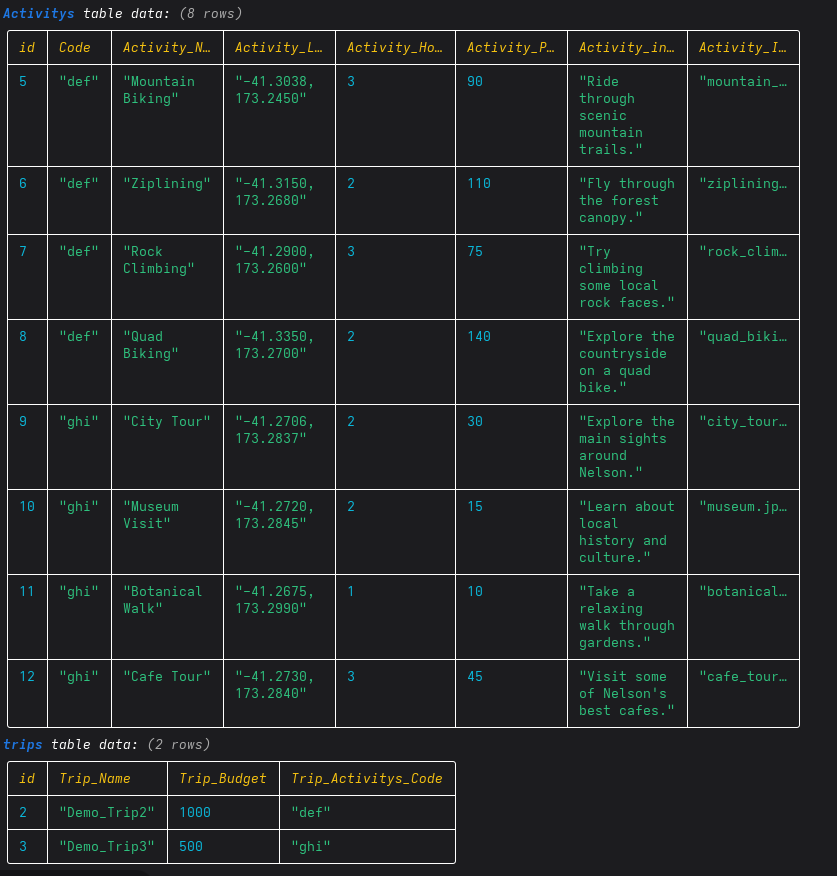

# Sprint 2 - Implement Database and Display of Test Data

## Sprint Goals

The goal of this sprint was to create the database for my road trip planning website and add test data. I also worked on retrieving information from the database and displaying it on the website.

### Specific Goals

- Create the database and its tables.
- Add test data for road trips, locations, activities and costs.
- Create a home page to display saved road trips.
- Create a details page to display information about a selected trip.
- Create database queries to retrieve all trips and specific trip details.
- Test the database and how the information is displayed.

## Testing Database and Test Data

I tested the database by adding sample road trip data and checking that the information was stored correctly. I then retrieved the data to check that it could be used by the website.
 
**Outcome:** [Write what happened when you tested the database and whether the data was stored correctly.]

**Screenshot:** Insert a screenshot of your database tables containing test data, or your database query and its output.

### Changes / Improvements

I checked that the database contained the information needed for the website. I made any necessary changes to fix missing or incorrect data.

**Screenshot:** Insert a screenshot of the final database structure or corrected test data.

## Testing Home Page

I tested the home page to check that road trips could be retrieved from the database and displayed correctly. I checked that the trip names and other information were visible and easy to read.

**Outcome:** [Describe whether the trips displayed correctly and mention any problems you found.]

**Screenshot:** Insert a screenshot of the home page displaying the test trips.

### Changes / Improvements

I checked the layout of the home page and made changes where needed to improve how the trip information was displayed.

**Screenshot:** Insert a screenshot of the final home page after any changes.

## Testing Trip Details

I tested the trip details page to check that the correct information was displayed for the selected road trip. This included checking the locations, activities and costs stored in the database.

**Outcome:** [Describe whether the correct trip details appeared and whether anything needed fixing.]

**Screenshot:** Insert a screenshot of a trip details page showing the test data.

### Changes / Improvements

I checked that the trip details were displayed clearly and that the correct information was shown for each trip. I fixed any issues found during testing.

**Screenshot:** Insert a screenshot of the final trip details page.

## Sprint Review

During this sprint, I worked on creating the database, adding test data and displaying the information on my website. This provides a starting point for storing and managing road trip information.

I also tested the main pages to check that the data could be retrieved and displayed correctly. Any problems found during testing were addressed where possible. The database and pages will provide a foundation for adding more features in the next sprint, such as budgeting and route planning.